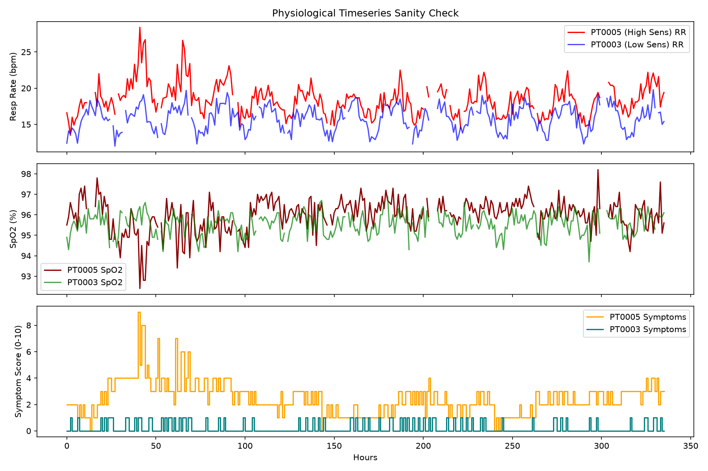

# RespiraTwin: Multimodal Respiratory Digital Twin for Asthma Exacerbation Risk Forecasting

**Happiest Health Digital Twin Challenge 2026 | Phase 1: Prototype & Code Submission**

RespiraTwin is a simulation-based respiratory digital twin proof of concept that combines electronic health records (EHRs), ambient air pollution observations, and simulated wearable and inhaler-adherence streams to estimate the probability of an asthma exacerbation onset over the next 24 hours. The system maintains an evolving virtual patient state, generates clinical reason codes relative to a personalized physiological baseline, and enables counterfactual what-if scenario exploration through an interactive clinician-facing dashboard.

> **Mandatory Clinical Disclaimer:** RespiraTwin is an algorithmic research prototype and demonstration proof of concept. All patient profiles, ambient pollution concentrations, wearable physiological signals, event labels, and clinical outcomes are synthetically generated by mathematical and epidemiological simulators. RespiraTwin does not claim clinical accuracy. Evaluated metrics quantify the learning of a simulated stochastic process, not real-world clinical prognosis. This software is not clinically validated and must never be used for medical diagnosis, clinical prognosis, treatment decisions, or medication alteration.

---

### At a Glance

| Metric / Dimension | Value | Simulation Context |
| :--- | :---: | :--- |
| **Holdout Test ROC-AUC** | **0.8205** | 95% Patient-Cluster Bootstrap CI: [0.7950, 0.8513]; Test PR-AUC: 0.4536; Brier score: 0.0526 (vs. 0.0705 base-rate baseline) |
| **Anticipated True Onsets** | **78.64%** | 162 of 206 true exacerbation onsets alerted in the 24-hour pre-onset window (100.0% of non-silent episodes) |
| **Early-Warning Lead Time** | **12.0 hours** | Median lead time across anticipated onsets (Interquartile Range: 10.0 hours; Q25 = 7.0h, Q75 = 17.0h) |
| **False Alert Burden** | **3.72 / pt-month** | Alert precision of 48.93% (321 / 656) vs. 8.96% precision and 54.62 false alerts / pt-month for a 50 µg/m³ PM2.5 threshold baseline |
| **What-If Monotonicity** | **100.0%** | Monotone in the expected direction in 100% of 200 sampled test patient-hours across 5 sweeps via 25 domain constraints |

*Simulation Caveat: All metrics evaluate performance on a synthetic cohort of 300 virtual patients over 60 days (432,000 patient-hours; 45 holdout test patients with 64,800 hours). Results measure fidelity to the simulator's generative rules and do not demonstrate performance on real patients.*

---

## Table of Contents

- [Project Links](#project-links)
- [Team and Institutional Details](#team-and-institutional-details)
- [1. Problem Statement](#1-problem-statement)
- [2. Healthcare Use Case](#2-healthcare-use-case)
- [3. Key Features](#3-key-features)
- [4. Data Streams and Provenance](#4-data-streams-and-provenance)
  - [Dataset Inventory](#dataset-inventory)
  - [Simulator Assumptions](#simulator-assumptions)
  - [Environmental-Data Units and AQI Interpretation](#environmental-data-units-and-aqi-interpretation)
- [5. Digital Twin Architecture](#5-digital-twin-architecture)
  - [Architecture Pipeline Diagram](#architecture-pipeline-diagram)
  - [Architecture Resources](#architecture-resources)
- [6. AI/ML Methodology](#6-aiml-methodology)
  - [Prediction Target and Patient-Level Splitting](#prediction-target-and-patient-level-splitting)
  - [Past-Looking Feature Engineering](#past-looking-feature-engineering)
  - [Personalized Physiological Baselines](#personalized-physiological-baselines)
  - [Monotonic Domain Constraints](#monotonic-domain-constraints)
  - [Model Selection and Trade-Off Analysis](#model-selection-and-trade-off-analysis)
  - [Post-Hoc Probability Calibration](#post-hoc-probability-calibration)
  - [Diagnosis of the Random Forest Gap (All Hours vs. At-Risk Hours)](#diagnosis-of-the-random-forest-gap-all-hours-vs-at-risk-hours)
- [7. Model Results](#7-model-results)
  - [Candidate Model Comparison](#candidate-model-comparison)
  - [Operational Model Test Performance](#operational-model-test-performance)
  - [Demonstration Risk Bands](#demonstration-risk-bands)
  - [Early-Warning and Clinical Alert Evaluation](#early-warning-and-clinical-alert-evaluation)
  - [Alert Precision vs. Baseline Policies](#alert-precision-vs-baseline-policies)
  - [False Alert Accounting and Stricter Breakdown](#false-alert-accounting-and-stricter-breakdown)
  - [Operating Point Sensitivity Analysis](#operating-point-sensitivity-analysis)
  - [Counterfactual What-If Effect Sizes and Adherence Diagnosis](#counterfactual-what-if-effect-sizes-and-adherence-diagnosis)
  - [Feature Group Ablation Study](#feature-group-ablation-study)
  - [Model Artifact and Provenance](#model-artifact-and-provenance)
- [8. Clinician Dashboard](#8-clinician-dashboard)
- [9. Installation and Execution](#9-installation-and-execution)
  - [Prerequisites](#prerequisites)
  - [Clone Repository and Set Up Environment](#clone-repository-and-set-up-environment)
  - [Run Automated Test Suite](#run-automated-test-suite)
  - [Launch the Dashboard](#launch-the-dashboard)
  - [Optional: Full Synthetic Data Pipeline Regeneration](#optional-full-synthetic-data-pipeline-regeneration)
- [10. Repository Structure](#10-repository-structure)
- [11. Submission Deliverables](#11-submission-deliverables)
- [12. Limitations, Privacy and Ethics](#12-limitations-privacy-and-ethics)
- [13. References and Attribution](#13-references-and-attribution)
- [14. License](#14-license)
- [Acknowledgements](#acknowledgements)

---

## Project Links

- **GitHub Repository:** https://github.com/dhruvishah-crypto/digital-twin-challenge
- **Live Demonstration:** [Installation and Execution](#9-installation-and-execution) guide.
- **20+ Minute Demonstration Video:** [https://youtu.be/TGKLNOVrROA](https://youtu.be/TGKLNOVrROA)
> 💡 **Note for Judges & Evaluators:** Please ensure playback quality is set to **1080p HD** (click the **⚙️ Settings / Gear icon** on the player $\rightarrow$ **Quality** $\rightarrow$ select **1080p**) so that interactive Streamlit telemetry dashboards, time-series metrics, and terminal code executions render with native full-resolution clarity.
- **Presentation Slides (PDF/PPT):** [docs/RespiraTwin_Pitch_Deck.pdf](docs/RespiraTwin_Pitch_Deck.pdf)
- **Architecture Diagram (PDF/PPT):** [docs/RespiraTwin_Architecture_Diagram_Updated.pdf](docs/RespiraTwin_Architecture_Diagram_Updated.pdf)

---

## Team and Institutional Details

- **Team Name:** AuraTwin
- **Challenge:** Happiest Health Digital Twin Challenge 2026
- **Project Track:** Respiratory Health / Asthma Exacerbation Risk Forecasting
- **Institution / College / Incubator:** Adani University
- **Team Leader:** Dhruvi Shah (GitHub: [dhruvishah-crypto](https://github.com/dhruvishah-crypto))
- **Official Submission Contact:** Contact telephone numbers and email addresses are provided through the challenge submission portal in accordance with privacy guidelines and are omitted from this public repository.

---

## 1. Problem Statement

Asthma is a major noncommunicable disease that affects hundreds of millions of children and adults globally ([WHO Asthma Fact Sheet](https://www.who.int/news-room/fact-sheets/detail/asthma); [Global Initiative for Asthma](https://ginasthma.org/)). Acute asthma exacerbations drive urgent emergency department attendances, hospital admissions, and substantial healthcare costs.

Exacerbations are triggered by interactions between acute environmental pollution spikes (PM2.5 and PM10), medication adherence lapses, viral prodromes, and individual baseline vulnerability. However, current clinical management remains primarily reactive: patients seek medical assistance only after acute bronchoconstriction and respiratory distress have already developed.

Static electronic health records cannot capture dynamic day-to-day deterioration, while city-wide air quality indices fail to reflect individual patient vulnerability or personalized physiological baselines. RespiraTwin investigates how multimodal information sources can be integrated into a personalized virtual representation that updates continuously to forecast exacerbation risk over a defined 24-hour horizon.

---

## 2. Healthcare Use Case

RespiraTwin implements a clinician-facing respiratory monitoring, risk forecasting, and scenario-planning workstation.

When reviewing a synthetic patient profile, a clinician can:
1. **Inspect Historical Profile and Baselines:** Review baseline resting vitals, disease severity phenotype, 12-month exacerbation history, prescribed controller inhalers, and diagnosed comorbidities.
2. **Track Multimodal Telemetry:** Monitor synchronous environmental exposure, resting respiratory rate, blood oxygen saturation (SpO2), heart rate, autonomic heart rate variability (HRV RMSSD), nocturnal sleep duration, and rescue inhaler logs.
3. **Forecast 24-Hour Exacerbation Risk:** Evaluate a calibrated probability and derived 0–100 risk score estimating the likelihood of an exacerbation onset within $(t, t + 24\text{h}]$.
4. **Interpret Signal Attribution:** Review signal contributions partitioned into 5 clinical signal families alongside rule-based clinical reason codes referenced against the patient's personalized baseline.
5. **Conduct Counterfactual What-If Exploration:** Test hypothetical scenarios (such as clean-air shelter, air filtration, or adherence reinforcement) to observe the model's response without mutating the underlying historical observation logs.

*The prototype illustrates a prospective decision-support workflow on synthetic data. It is not clinically validated and does not claim to prevent exacerbation events or replace clinical judgment.*

---

## 3. Key Features

- **Multimodal Temporal Fusion:** Unifies static EHR attributes with continuous ambient pollution, wearable telemetry, medication logs, and symptom diaries.
- **Personalized 24-Hour Risk Forecasting:** Estimates onset probability for the subsequent 24 hours, paired with a derived 0–100 presentation score and demonstration risk bands.
- **Contamination-Resistant Dynamic Baselines:** Computes individualized resting norms over a 14–30 day rolling window that explicitly excludes the most recent 72 hours, preventing pre-attack prodromal drift from distorting baseline definitions.
- **Transparent Signal Attribution and Reason Codes:** Aggregates feature contributions into 5 signal families (Atmospheric Pollution, Breathing & Oxygenation, Rescue & Symptoms, Medication Adherence, Baseline History) and produces human-readable clinical reason codes.
- **Stateful Digital Twin Engine:** Maintains an evolving patient state with chronological audit logs recording prediction trajectories and risk transitions over time.
- **Counterfactual What-If Simulation:** Evaluates model responses to simulated environmental and behavioral interventions through coherent parameter overrides while maintaining historical data integrity.
- **Interactive Clinician Dashboard:** Implemented in Streamlit and Plotly with wide-format multi-panel views, synchronous telemetry charts, and simulated patient replay controls.

---

## 4. Data Streams and Provenance

All bundled datasets in this repository are synthetic or simulated. The ambient pollution series reflects illustrative urban Delhi-range concentrations and does not represent actual monitoring station records.

### Dataset Inventory

| Dataset File | File Path | Provenance | Description |
| :--- | :--- | :--- | :--- |
| **Synthetic EHR Cohort** | [data/patients.csv](data/patients.csv) | `simulated` | 300 synthetic patient records with demographics, asthma severity, prior exacerbations, prescribed inhalers, baseline vitals, and comorbidities. |
| **Sample EHR Profiles** | [data/sample_patients.csv](data/sample_patients.csv) | `simulated` | Benchmark sample of patient profiles for initial inspection and lightweight testing. |
| **Hidden Latent Truth** | [data/latent_truth.csv](data/latent_truth.csv) | `simulated (hidden)` | Ground-truth biological vulnerability factors used exclusively by the event simulator. Strictly isolated; never accessed by feature engineering or model training. |
| **Ambient Pollution Series** | [data/sample_pollution.csv](data/sample_pollution.csv) | `simulated` | 60 days (1,440 hours) of synthetic PM2.5 and PM10 concentrations (illustrative urban Delhi-range levels; not real measurements). |
| **Pollution Metadata** | [data/sample_pollution.json](data/sample_pollution.json) | `metadata` | Metadata sidecar defining units, AQI calculation methodology, and instructions for substituting real CPCB/OpenAQ measurements. |
| **Simulated Wearables** | `data/patient_timeseries.csv` | `simulated` | 432,000 hourly observations across 300 patients covering RR, HR, HRV RMSSD, SpO2, sleep, steps, adherence, rescue puffs, and symptoms (rebuilt via pipeline scripts; gitignored). |
| **Sample Wearables** | [data/sample_wearables.csv](data/sample_wearables.csv) | `simulated` | 1,000-row sample of wearable time series for testing. |
| **Simulated Episodes** | [data/episodes.csv](data/episodes.csv) | `simulated (eval)` | 1,398 discrete exacerbation episodes with onset/end timestamps, duration, prodrome, and silent flags. Used strictly for evaluation; never used as model features. |
| **Sample Episodes** | [data/sample_episodes.csv](data/sample_episodes.csv) | `simulated (eval)` | 100-row sample of exacerbation episodes. |
| **Simulation Configs** | [data/events_config.json](data/events_config.json), [data/patients_config.json](data/patients_config.json) | `metadata` | Serialization sidecars capturing simulator parameters, positive event rates, and random seeds. |
| **Replay Episode Cache** | [data/replay_episodes.json](data/replay_episodes.json) | `simulated` | Pre-indexed test episode windows supporting step-by-step patient replay in the clinician dashboard. |
| **Sample Labeled Data** | [data/sample_labeled_dataset.csv](data/sample_labeled_dataset.csv) | `simulated` | 1,000-row sample of fused features paired with binary `event_next_24h` target labels. |

### Simulator Assumptions

The event generator ([src/simulate_events.py](src/simulate_events.py)) and wearable simulator ([src/simulate_wearables.py](src/simulate_wearables.py)) operate under explicit mathematical assumptions documented in [docs/data_dictionary.md](docs/data_dictionary.md) and [data/events_config.json](data/events_config.json):

1. **Exogenous Hourly Hazard Model:** Discrete exacerbation onsets are sampled sequentially per patient from an hourly hazard driven strictly by exogenous drivers and baseline traits:
   $$\text{logit\_hazard}(t) = \beta_0 + \beta_{\text{vuln}} (\text{vuln} - 0.5) + \beta_{\text{sev}} (\text{sev} - 2) + \beta_{\text{prior}} (\min(\text{prior}, 4) - 1.5) + \beta_{\text{pm25}} \max(0, \text{pm25}_{24h} - 35)(1 + 0.35 \cdot \text{poll\_sens}) + \beta_{\text{lapse}} \cdot \text{lapse} + \epsilon_t + \eta_t$$
   - Baseline intercept: $\beta_0 = -5.85$ (calibrates inter-episode frequency to ~1 episode per 10–25 patient-days).
   - Exogenous parameters: Hidden latent vulnerability ($\beta = 0.65$), asthma severity ($\beta = 0.35$), 12-month prior exacerbations ($\beta = 0.12$), rolling 24h PM2.5 excess above 35 µg/m³ ($\beta = 0.012$), controller adherence lapse ($\beta = 0.55$), Gaussian noise ($\sigma = 0.35$), and stochastic shocks ($P = 1.2\%$).
2. **Episode Dynamics and Refractory Window:**
   - **Episode Duration:** Uniformly sampled between 12 and 48 hours.
   - **Prodromal Window:** Uniformly sampled between 6 and 24 hours prior to onset.
   - **Refractory Period:** A strict 72-hour refractory window is enforced after each episode ends during which new onset hazard is mathematically zero.
   - **30% Silent Episodes:** 30% of episodes are randomly designated as "silent" (negligible prodromal drift; prodrome multiplier $\approx 0.08$), preventing trivial signal detection.
   - **Non-Silent Prodromal Drift:** Accelerating ramp $\phi(t) = \tau^{1.3} \cdot \alpha$ with rising respiratory rate (+2.0 to +4.5 breaths/min), falling SpO2 (-1.5% to -3.5%), escalating rescue puffs (1–3 puffs), and worsening symptom score (+2.0 to +4.0).
   - **Recovery Phase:** An 18-hour post-episode recovery decay returns physiological channels smoothly to baseline.
3. **Cohort Scale:** 300 patients across 60 days generate 432,000 hourly observations, 1,398 total episodes, and an overall positive-label rate of 7.77% (train: 7.80%, val: 7.74%, test: 7.63%).

*These equations and dynamics represent simulation assumptions designed to benchmark machine learning algorithms; they are not established medical models.*

### Environmental-Data Units and AQI Interpretation

- **Physical Concentrations:** PM2.5 and PM10 are reported in plain-text units of µg/m³ and serve as the primary model features.
- **Derived AQI:** The `aqi` column is a derived US-EPA-style index calculated from PM2.5 concentrations. It is **not** India's Central Pollution Control Board (CPCB) National Air Quality Index (NAQI). It is displayed as secondary context only and is not fed as a primary feature to the models.
- **Substituting Real Air Quality Data:** To replace synthetic pollution data with real measurements, download hourly PM2.5 and PM10 series from CPCB CCR (https://app.cpcbccr.com/AQI_India/) or OpenAQ (https://docs.openaq.org/about/about) and format into `data/sample_pollution.csv` with columns: `timestamp`, `pm25`, `pm10`, `city`, `source`, `last_updated`.

---

## 5. Digital Twin Architecture

The digital twin pipeline ingests multimodal inputs, applies temporal staleness and leakage guardrails, fits personalized baselines, executes monotonic inference, and drives an interactive clinician interface.

```
+---------------------------------------------------------------------------------------------------+
|                                  1. MULTIMODAL INGESTION LAYER                                    |
|  Synthetic EHR Profiles           Synthetic Pollution Series          Simulated Wearables & Logs  |
|  (Demographics, Baselines,        (Hourly PM2.5, PM10,                (RR, HR, HRV, SpO2, Sleep,  |
|   Severity, Comorbidities)         Derived US-EPA AQI)                 Adherence, Puffs, Symptoms)|
+-------------------------------------------------+-------------------------------------------------+
                                                  |
                                                  v
+---------------------------------------------------------------------------------------------------+
|                            2. TEMPORAL FEATURE FUSION & GUARDRAILS                                |
|  Data Schema Validation           Strict Past-Looking Windows         Contamination-Resistant     |
|  (Forward-fill tracking,          (6h / 24h / 72h rolling means,      Personalized Baseline       |
|   6-hour staleness cutoffs)        min, max, trends, sleep deficit)    (14-30d excluding last 72h) |
+-------------------------------------------------+-------------------------------------------------+
                                                  |
                                                  v
+---------------------------------------------------------------------------------------------------+
|                                  3. DIGITAL TWIN ENGINE CORE                                      |
|  Twin State Representation        Calibrated Monotonic Model          Transparent Explainability  |
|  (Evolving patient profile,       (HistGradientBoosting + 25 domain   (5 signal families, baseline|
|   vital trends, quality flags)     constraints + Isotonic calibration) reason code generation)    |
|                                                 |                                                 |
|                                                 v                                                 |
|                                   Chronological History Store                                     |
|                                   (Immutable audit log of predictions & state shift triggers)     |
+-------------------------------------------------+-------------------------------------------------+
                                                  |
                                                  v
+---------------------------------------------------------------------------------------------------+
|                        4. INTERACTIVE CLINICIAN DASHBOARD & WHAT-IF LAB                           |
|  Patient Overview Banner          Synchronous Telemetry Charts        Calibrated Risk & Reason    |
|  (Clear synthetic markings)       (Plotly multi-channel vitals)        Codes (0-100 Score, Bands) |
|                                                 |                                                 |
|  What-If Scenario Laboratory      Early-Warning Benchmarks            Step-by-Step Patient Replay |
|  (Coherent parameter overrides)   (Anticipated vs Missed Audits)      (Stream with ground truth)  |
+---------------------------------------------------------------------------------------------------+
```

### Architecture Resources

- Detailed architectural documentation and editable Mermaid diagram: [docs/architecture.md](docs/architecture.md)
- Complete variable definitions and data provenance: [docs/data_dictionary.md](docs/data_dictionary.md)
- Machine learning evaluation card: [docs/model_card.md](docs/model_card.md)

---

## 6. AI/ML Methodology

### Prediction Target and Patient-Level Splitting

- **Target Label (`event_next_24h`):** Defined as $\text{event\_next\_24h}(t) = 1$ if an exacerbation onset occurs strictly within $(t, t + 24\text{h}]$, and $0$ otherwise.
- **Patient-Level Stratification:** Patients are split into train, validation, and holdout test sets stratified by individual exacerbation rates. Zero data leakage is asserted: no patient appears in more than one partition.

| Split Partition | Patients Count | Total Hourly Observations | Exacerbation Event Rate | Purpose |
| :--- | :---: | :---: | :---: | :--- |
| **Train** | 210 | 302,400 | 7.80% | Model parameter optimization |
| **Validation** | 45 | 64,800 | 7.74% | Hyperparameter tuning, isotonic calibrator fitting, threshold selection |
| **Holdout Test** | 45 | 64,800 | 7.63% | Independent final model evaluation and alert-burden auditing |

### Past-Looking Feature Engineering

There are 52 features, built from past-only rolling windows of pollution, respiratory, oxygenation, heart rate, sleep, rescue use, symptoms, adherence and EHR baseline fields. The feature pipeline ([src/build_features.py](src/build_features.py)) ensures zero lookahead leakage by calculating aggregations strictly over backward-looking temporal buffers. The complete feature list is defined in [models/feature_columns.json](models/feature_columns.json).

### Personalized Physiological Baselines

A personalized physiological baseline is computed dynamically for each patient across a 14–30 day rolling window that **explicitly excludes the most recent 72 hours**. This design ensures acute pre-attack prodromal changes (such as gradual tachypnea or subclinical desaturation) do not contaminate or elevate the patient's baseline norm.

### Monotonic Domain Constraints

To ensure counterfactual validity during clinician what-if testing, the operational `HistGradientBoostingClassifier` enforces 25 mathematical monotonic constraints serialized in [models/monotonic_constraints.json](models/monotonic_constraints.json):

| Feature Group | Direction | Constrained Feature Names | Pathophysiological Rationale |
| :--- | :---: | :--- | :--- |
| **Atmospheric Pollution** | **+1** (Non-decreasing) | `pm25_rolling_mean_6h`, `pm25_rolling_max_6h`, `pm25_rolling_mean_24h`, `pm25_rolling_max_24h`, `pm25_rolling_mean_72h`, `pm25_rolling_max_72h`, `pm10_rolling_mean_24h` | Air pollutants trigger neutrophilic airway inflammation; higher pollution exposure cannot reduce risk. |
| **Respiratory Rate Overrides** | **+1** (Non-decreasing) | `respiratory_rate_raw`, `rr_deviation_from_baseline`, `rr_rolling_mean_6h`, `rr_rolling_mean_24h`, `rr_recent_vs_usual` | Tachypnea indicates ventilatory demand and airway narrowing; higher respiratory rates cannot lower risk. |
| **Rescue Inhaler Demand** | **+1** (Non-decreasing) | `rescue_puffs_sum_6h`, `rescue_puffs_sum_24h`, `rescue_puffs_trend_24h` | Frequent SABA use reflects breakthrough bronchospasm; higher puff demand cannot reduce risk. |
| **Symptom Scores** | **+1** (Non-decreasing) | `symptom_score_raw`, `symptom_score_mean_6h`, `symptom_score_mean_24h`, `symptom_score_trend_24h` | Worsening cough, wheeze, and dyspnea correlate with flare onset; higher scores cannot reduce risk. |
| **Oxygen Desaturation Drop** | **+1** (Non-decreasing) | `spo2_drop_from_baseline` | Greater oxygen drop below baseline indicates worsening ventilation-perfusion mismatch. |
| **Medication Adherence** | **-1** (Non-increasing) | `controller_adherence_7d` | Anti-inflammatory controller therapy suppresses mucosal inflammation; higher adherence cannot elevate risk. |
| **Oxygen Saturation Overrides** | **-1** (Non-increasing) | `spo2_raw`, `spo2_mean_6h`, `spo2_min_6h`, `spo2_recent_vs_usual` | Stable arterial oxygenation reflects preserved alveolar ventilation; higher oxygen saturation cannot elevate risk. |
| **Recovery-Overlapping Signals** | **0** (Relaxed) | `rr_rolling_std_24h`, `spo2_mean_24h`, `spo2_min_24h`, `sleep_deficit`, `sleep_hours`, `steps_rolling_sum_24h` | Relaxed to eliminate false-positive ranking penalties during post-episode recovery. |
| **Autonomic & Static EHR** | **0** (Unconstrained) | `heart_rate_*`, `hrv_*`, `age`, comorbidities | Autonomic vitals exhibit non-linear autonomic tone interactions and remain unconstrained. |

### Model Selection and Trade-Off Analysis

Candidate architectures were evaluated on the validation cohort:
1. **Logistic Regression (Linear Baseline):** Achieved validation PR-AUC 0.2792. Serves as a reference showing that non-linear feature interactions provide substantial predictive gain.
2. **Random Forest (Unconstrained Benchmark):** Achieved validation PR-AUC 0.4698. Serves as an unconstrained upper-performance benchmark. However, decision trees without constraints allow non-monotonic splits that can produce clinically invalid risk behavior in what-if scenarios.
3. **Candidate Relaxed HistGradientBoosting (Rejected):** Achieved the highest validation PR-AUC (0.4831) by applying constraints only to deviation features. However, it was **rejected** after failing the what-if monotonicity validity check on 200 sampled test patient-hours: its respiratory rate sweep was monotone in only 57.5% of patient-hours, and its oxygen saturation sweep was monotone in only 7.5% of patient-hours.
4. **Operational Constrained HistGradientBoosting (Selected):** Achieved validation PR-AUC 0.4675 (within 0.0023 of unconstrained Random Forest) while achieving **100.0% monotonicity compliance across all 5 clinical what-if scenario sweeps** on 200 holdout test patient-hours. It was selected as the operational model.

Hyperparameters for the operational model: learning rate 0.02, max iterations 600, max leaf nodes 31, min samples leaf 50, L2 regularization 1.0.

### Post-Hoc Probability Calibration

Because tree ensemble scores can deviate from true probabilities, post-hoc **Isotonic Regression** was fitted strictly on **validation split patient hours** (never on test data). The operational decision threshold ($\tau = 0.2375$) was selected to maximize the validation F1 score.

### Diagnosis of the Random Forest Gap (All Hours vs. At-Risk Hours)

On **all test hours**, unconstrained Random Forest appears to lead the operational constrained model (Test PR-AUC: 0.4782 vs. 0.4688; validation gap: 0.0023; full-constraint validation gap: 0.0903).

Detailed diagnosis ([models/metrics.json](models/metrics.json)) reveals why:
- Across the cohort, **31.6% of all observation hours** occur inside active exacerbations, 18-hour post-episode recovery, or 72-hour refractory windows.
- During recovery hours, patient vitals and symptoms remain elevated, but the simulator assigns zero hazard for a new onset.
- Unconstrained trees exploit arbitrary non-monotonic splits to artificially suppress risk predictions during recovery periods. By contrast, constrained models are bound by domain priors to keep predicted risk elevated when vitals and symptoms are abnormal, incurring false-positive ranking penalties during recovery.
- When evaluated strictly on true **at-risk clinical hours** (excluding active episodes, recovery, and refractory periods):
  - On validation at-risk hours, the operational model achieves PR-AUC **0.4951**, matching Random Forest (**0.4978**) within **0.0027**.
  - On holdout test at-risk hours, the operational model achieves PR-AUC **0.4977**, closely matching Random Forest (**0.5048**).

---

## 7. Model Results

> **Simulation Disclaimer:** All performance metrics below evaluate the learning of a simulated disease process on a synthetic cohort of 300 patients across 60 days (432,000 total hours; 64,800 test hours; 206 true test onsets). They do not represent real-world clinical validation.

### Candidate Model Comparison

The following table reports candidate model performance on the holdout test set before post-hoc probability calibration:

| Model Architecture | Constraint Setup | Validation PR-AUC | Test PR-AUC (All Hours) | Test PR-AUC (At-Risk Hours) | Test ROC-AUC | Test Brier Score | What-If Monotonicity (200 Test Hours) | Selection Role |
| :--- | :---: | :---: | :---: | :---: | :---: | :---: | :---: | :--- |
| **Logistic Regression** | Unconstrained linear | 0.2792 | 0.2729 | 0.3133 | 0.7776 | 0.0630 | Monotone linear | Reference Baseline |
| **Random Forest** | Unconstrained trees | 0.4698 | 0.4782 | 0.5048 | 0.8230 | 0.0526 | Unconstrained (non-monotone splits) | Benchmark |
| **Candidate Relaxed HGB** | Partial constraints | 0.4831 | — | — | — | — | Failed (RR: 57.5%, SpO2: 7.5%) | Rejected Candidate |
| **Operational Constrained HGB** | **25 Domain Constraints** | **0.4675** | **0.4688** | **0.4977** | **0.8218** | **0.0527** | **100.0% Across All 5 Sweeps** | **Selected Operational Twin** |

### Operational Model Test Performance

Applying post-hoc isotonic probability calibration (fitted strictly on validation patients) to the operational model produces the final calibrated test performance at the operational decision threshold ($\tau = 0.2375$):

| Diagnostic Metric | Point Estimate | 95% Patient-Cluster Bootstrap CI | Baseline / Reference | Interpretation |
| :--- | :---: | :---: | :---: | :--- |
| **ROC-AUC** | **0.8205** | [0.7950, 0.8513] | 0.5000 (Random) | Strong discriminative ability across decision thresholds |
| **PR-AUC (Average Precision)** | **0.4536** | [0.4036, 0.5100] | 0.0763 (Test Base Rate) | Evaluates precision-recall trade-off on minority event class |
| **Brier Score** | **0.0526** | [0.0471, 0.0600] | 0.0705 (Base-Rate Brier) | Mean squared probability error (0.0179 improvement over baseline) |
| **Calibration Slope** | **0.9786** | — | 1.0000 (Ideal) | Improved from 0.9321 before calibration |
| **Calibration Intercept** | **-0.0041** | — | 0.0000 (Ideal) | Improved from -0.1623 before calibration |
| **Decision Threshold** | **0.2375** | — | — | Tuned on validation split to maximize F1 score |
| **Precision** | **0.5794** | — | 0.0763 (Base Rate) | Reconciled: 1,726 / (1,726 + 1,253) = 0.5794 |
| **Recall (Sensitivity)** | **0.3491** | — | — | Reconciled: 1,726 / (1,726 + 3,218) = 0.3491 |
| **F1 Score** | **0.4357** | — | — | Harmonic mean of precision and recall at threshold |

**Reconciled Test Confusion Matrix (64,800 hourly observations):**
- True Positives (TP): **1,726**
- False Positives (FP): **1,253**
- False Negatives (FN): **3,218**
- True Negatives (TN): **58,603**
- Reconciled Total Positive Alerts: $1,726 + 1,253 = 2,979$
- Reconciled Total Positive Event Labels: $1,726 + 3,218 = 4,944$

### Demonstration Risk Bands

The dashboard stratifies calibrated probabilities into three demonstration risk tiers. Observed event rates on the holdout test set confirm monotonic ordering:

| Demonstration Risk Band | Calibrated Probability Range | Observed Test Event Rate | Monotonicity Check |
| :--- | :---: | :---: | :--- |
| **Low** | $P < 0.0679$ | **2.61%** | Baseline routine observation |
| **Watch** | $0.0679 \le P < 0.1604$ | **9.28%** | Elevated monitoring tier |
| **High** | $P \ge 0.1604$ | **38.43%** | Alert notification tier |

*Monotonicity Assertion:* Empirical event rate satisfies $\text{Low (2.61\%)} < \text{Watch (9.28\%)} < \text{High (38.43\%)}$.

### Early-Warning and Clinical Alert Evaluation

Evaluated across 2,700 holdout test patient-days (45 test patients × 60 days) and 206 true exacerbation onsets at the operational threshold ($\tau = 0.2375$):
- **Anticipated Onset:** At least one alert occurs strictly before onset with lead time $\ge 1\text{h}$ and within $24\text{h}$: $[T_{\text{onset}} - 24\text{h}, T_{\text{onset}} - 1\text{h}]$.
- **Late Detection:** If not anticipated, first alert occurs within 6 hours post-onset: $[T_{\text{onset}}, T_{\text{onset}} + 6\text{h}]$.
- **Missed Onset:** Neither anticipated nor detected within 6 hours post-onset.

| Exacerbation Cohort | Total Onsets | Anticipated ($\ge 1\text{h}$ lead) | Late Detection ($\le 6\text{h}$ post) | Missed Onsets | Median Lead Time | Lead Time IQR |
| :--- | :---: | :---: | :---: | :---: | :---: | :---: |
| **All Test Episodes** | 206 | **78.64%** (162) | 5.34% (11) | 16.02% (33) | **12.0 hours** | 10.0 hours |
| **Non-Silent Episodes** (Visible Prodrome) | 138 | **100.00%** (138) | 0.00% (0) | 0.00% (0) | **11.0 hours** | 9.0 hours |
| **Silent Episodes** (Negligible Prodrome) | 68 | **35.29%** (24) | 16.18% (11) | 48.53% (33) | **16.0 hours** | 16.0 hours |

*Silent Episode Caveat: In the simulator, 30% of episodes are designated as silent with weak physiological drift. RespiraTwin anticipates only 35.29% of silent episodes, missing 48.53%.*

### Alert Precision vs. Baseline Policies

Consecutive hourly alerts within a 6-hour cooldown window are merged into distinct alert episodes. An alert episode is classified as true if followed by an exacerbation onset within 24 hours.

| Alert Policy | Total Alert Episodes | Followed by Onset (<24h) | Alert Precision | Anticipated Onset Share | False Alert Episodes / Pt-Month |
| :--- | :---: | :---: | :---: | :---: | :---: |
| **Random Matched Schedule (20 seeds)** | 651 | 50 | 7.66% | 22.67% | 6.68 |
| **PM2.5 Rule ($\ge 50$ µg/m³)** | 5,400 | 484 | 8.96% | 83.01% | 54.62 |
| **PM2.5 + Low Adherence ($<80\%$)** | 1,010 | 130 | 12.87% | 21.84% | 9.78 |
| **RespiraTwin Operational Model** | **656** | **321** | **48.93%** | **78.64%** | **3.72** |

*Honest Baseline Trade-Off Note: The simple PM2.5 threshold rule anticipates a slightly higher fraction of true onsets (83.01% vs. 78.64%) by firing indiscriminately whenever pollution is high. However, this causes severe alarm fatigue: 5,400 alert episodes, 54.62 false alert episodes per patient-month (more than 14 times RespiraTwin's rate), and an alert precision of only 8.96%. RespiraTwin achieves 48.93% alert precision with 3.72 false alert episodes per patient-month.*

### False Alert Accounting and Stricter Breakdown

From [models/metrics.json](models/metrics.json), the 656 total alert episodes break down as follows:
- **Alerts Followed by Onset within 24h (True Warnings):** **321**
- **Alerts During Active Episodes $[T_{\text{onset}}, T_{\text{end}})$:** **32** (patient already experiencing active flare; clinically expected but not early warnings)
- **Alerts During Post-Episode Recovery $[T_{\text{end}}, T_{\text{end}} + 18\text{h})$:** **0**
- **Total Alerts During Active or Recovery Periods:** **32**
- **Alerts During 72h Refractory Periods:** **15**
- **False Alerts Outside Episodes:** **303** (**3.37 per patient-month**)
- **Total Classified False Alert Episodes:** **335** (**3.72 per patient-month**)

### Operating Point Sensitivity Analysis

Clinicians can adjust the decision threshold depending on whether the operational goal prioritizes low alarm fatigue or maximum early warning sensitivity:

| Operating Setting | Decision Threshold | Validation Tuning Rule | Anticipated Share | Late Detection | Missed Share | Median Lead Time | False Alerts / Pt-Month | Alerts / Pt-Day |
| :--- | :---: | :--- | :---: | :---: | :---: | :---: | :---: | :---: |
| **High Precision (Low Alarm)** | 0.2748 | Validation precision $\ge 0.60$ | 76.70% (158) | 3.40% (7) | 19.90% (41) | 11.0h | **1.74** | 0.1644 |
| **Balanced (Validation F1)** | **0.2375** | Maximize validation F1 score (operational default) | **78.64% (162)** | **5.34% (11)** | **16.02% (33)** | **12.0h** | **3.72** | **0.2430** |
| **High Recall (Early Warning)** | 0.1372 | Validation recall $\ge 0.50$ | 88.35% (182) | 6.80% (14) | 4.85% (10) | 17.0h | **11.96** | 0.5630 |

### Counterfactual What-If Effect Sizes and Adherence Diagnosis

As computed across all 64,800 test patient-hours in [models/whatif_effects.json](models/whatif_effects.json):

| What-If Slider | Sweep Range & Units | Low Band Typical Effect | Watch Band Typical Effect | High Band Typical Effect | Pre-Onset (1-24h) Effect | High Band Status |
| :--- | :--- | :---: | :---: | :---: | :---: | :--- |
| **PM2.5 Exposure** | 10.0 -> 150.0 µg/m³ | +2.06% | +8.58% | **+14.21%** | +7.00% | Active Effect |
| **Controller Adherence** | 10% -> 100% adherence | 0.00% | 0.00% | **0.00%** | 0.00% | Small Effect in Model (<0.005) |
| **Respiratory Rate Shift** | -3.0 -> +5.0 breaths/min | +2.69% | +12.60% | **+26.27%** | +13.73% | Active Effect |
| **SABA Rescue Puffs** | 0 -> 8 puffs in 24h | 0.00% | +2.60% | **+3.77%** | +1.33% | Active Effect |
| **SpO2 Desaturation** | 98% -> 88% arterial O2 | +6.81% | +36.67% | **+84.31%** | +45.54% | Active Effect |

> **Adherence Diagnosis and Tree Split Share Analysis:**
> Diagnostic profiling in [models/adherence_diagnosis.json](models/adherence_diagnosis.json) explains why isolated 7-day adherence changes produce small risk deltas:
> 1. **Ceiling Clustering in Data:** Adherence exhibits strong ceiling clustering—**73.51% of train hours and 77.31% of test hours are at 100% adherence** (mean 0.877 train, 0.904 test; median 1.00; only 21.28% train and 17.36% test hours fall below the 80% threshold).
> 2. **Ensemble Tree Splits:** Across all 600 decision trees (32,330 total splits), only **284 splits (0.878%)** utilize `controller_adherence_7d`.
> 3. **Permutation Importance:** On the validation set, permuting `controller_adherence_7d` drops PR-AUC by 0.0062 (ranked #15 out of 52 features). Splits are dominated by acute deterioration signals (`spo2_min_24h`: 0.2364, `spo2_drop_from_baseline`: 0.1576, `baseline_spo2`: 0.1028, `rr_recent_vs_usual`: 0.0977).
> 4. **Combined Clinical Preset:** In clinical practice, non-adherence does not trigger acute bronchospasm in isolation; rather, missed anti-inflammatory controller therapy escalates airway irritability, which elevates symptoms and triggers compensatory rescue inhaler use. The dashboard's "Adherence Lapse" preset implements a combined scenario (adherence lapse paired with rescue inhaler escalation) to reflect this clinical reality.

### Feature Group Ablation Study

Evaluating marginal group contributions under simulator assumptions ([models/metrics.json](models/metrics.json)):

| Ablation Condition | Features Removed | Test PR-AUC | Test ROC-AUC | Test Brier Score | Impact Assessment |
| :--- | :---: | :---: | :---: | :---: | :--- |
| **Full Model (All Features)** | 0 | **0.4536** | **0.8205** | **0.0526** | Complete operational model |
| **No Pollution Features** | 8 | 0.4422 | 0.8226 | 0.0531 | Minor PR-AUC drop; pollution serves as an exogenous trigger |
| **No Wearable Telemetry** | 24 | **0.1655** | **0.7222** | **0.0669** | **Severe degradation**; wearable vitals are essential for prodrome detection |
| **No Adherence Feature** | 1 | 0.4524 | 0.8226 | 0.0530 | Minimal change due to ceiling clustering and tree split share |

### Model Artifact and Provenance

- **Model File Path:** [models/model.joblib](models/model.joblib) (tracked in git)
- **File Size:** 2,251,830 bytes (~2.15 MB)
- **SHA-256 Checksum:** `bf587af9370a682de3f9888516aaa619650a8b396b3ee3cc942b9c28906feae0`
- **Serialization Environment:** `scikit-learn==1.9.1`, `joblib==1.6.0`, `numpy==2.5.4`, `pandas==3.0.6`
- **Security Warning:**
  > Joblib and Python pickle serializations can execute arbitrary code during unpickling. Only load `models/model.joblib` from this verified repository clone. Never load untrusted binary artifacts from unverified third-party sources.

---

## 8. Clinician Dashboard

The clinician workstation is implemented in Streamlit ([app.py](app.py)) and Plotly:

- **Patient Overview:** Displays patient demographics, baseline resting vitals, disease severity, 12-month exacerbation history, and prominent synthetic patient banners.
- **Synchronous Telemetry Charts:** Renders multi-panel Plotly time-series tracking ambient PM2.5 and PM10, resting respiratory rate, blood oxygen saturation (SpO2), heart rate, HRV RMSSD, sleep, and rescue inhaler logs.
- **Risk Forecast and Attribution:** Displays the calibrated 24-hour risk probability, derived 0–100 score, demonstration risk band, 5-family signal attribution, and personalized baseline reason codes.
- **Twin History Timeline:** Logs chronological risk forecasts and highlights risk tier transitions.
- **What-If Scenario Laboratory:** Provides interactive sliders to explore hypothetical variations in PM2.5, respiratory rate, SpO2, rescue puffs, and controller adherence, with dynamic effect size badges and monotonicity enforcement.
- **Step-by-Step Replay Control:** Replays simulated observations with an optional ground-truth toggle for evaluation auditing.



*Figure: Verification sanity check of simulated multi-channel time series.*

[Placeholder: Clinician dashboard interactive view screenshots on synthetic patient data - insert before submission]

---

## 9. Installation and Execution

### Prerequisites

- **Python Version:** Python 3.11+ (tested on 3.14.3, Windows)
- **Git**
- **Operating Systems:** Windows 10/11, macOS, or Linux.

### Clone Repository and Set Up Environment

```bash
git clone https://github.com/dhruvishah-crypto/digital-twin-challenge.git
cd digital-twin-challenge
```

Create and activate a virtual environment:

**Windows PowerShell:**
```powershell
python -m venv .venv
.\.venv\Scripts\Activate.ps1
```

**Windows Command Prompt:**
```bat
python -m venv .venv
.\.venv\Scripts\activate.bat
```

**Linux / macOS:**
```bash
python -m venv .venv
source .venv/bin/activate
```

Install pinned dependencies:
```bash
python -m pip install --upgrade pip
pip install -r requirements.txt
```

### Run Automated Test Suite

Run pytest to check pipeline integrity, data leakage safeguards, feature parity, monotonic constraints, and baseline computations:
```bash
pytest -v
```
*Expected test outcome: 49 passed automated unit tests.*

### Launch the Dashboard

```bash
streamlit run app.py
```
Open your browser at `http://localhost:8501`.

### Optional: Full Synthetic Data Pipeline Regeneration

The trained model artifact [models/model.joblib](models/model.joblib) is included directly in the repository (confirmed via `git ls-files`). Retraining is not required to run the dashboard.

If full regeneration of synthetic cohorts, features, and model training is desired, run the verified sequence:

```bash
# 1. Generate synthetic EHR profiles (300 patients)
python src/generate_data.py --num_patients 300 --seed 42 --output_dir data

# 2. Ingest / generate ambient pollution time-series (60 days)
python src/ingest_pollution.py --days 60 --city Delhi --seed 42 --output data/sample_pollution.csv

# 3. Simulate wearable signals and exacerbation episodes (60 days)
python src/simulate_wearables.py --patients_file data/patients.csv --pollution_file data/sample_pollution.csv --days 60 --seed 42 --output data/patient_timeseries.csv --episodes_output data/episodes.csv

# 4. Construct past-looking feature vectors (zero lookahead leakage)
python src/build_features.py --ehr data/patients.csv --wearables data/patient_timeseries.csv --pollution data/sample_pollution.csv --output data/features.csv

# 5. Label 24h lookahead target events
python src/simulate_events.py --features data/features.csv --episodes data/episodes.csv --latent data/latent_truth.csv --output data/labeled_dataset.csv --seed 42

# 6. Train, calibrate, and evaluate operational constrained model
python src/train_model.py --data data/labeled_dataset.csv --features_json models/feature_columns.json --monotonic_json models/monotonic_constraints.json --models_dir models --seed 42
```

---

## 10. Repository Structure

```text
digital-twin-challenge/
├── .gitignore
├── Agents.md
├── LICENSE
├── Makefile
├── README.md
├── app.py
├── requirements.txt
├── run_all.sh
├── data/
│   ├── episodes.csv
│   ├── episodes.json
│   ├── events_config.json
│   ├── latent_truth.csv
│   ├── patient_timeseries.json
│   ├── patients.csv
│   ├── patients_config.json
│   ├── replay_episodes.json
│   ├── sample_episodes.csv
│   ├── sample_labeled_dataset.csv
│   ├── sample_patients.csv
│   ├── sample_pollution.csv
│   ├── sample_pollution.json
│   └── sample_wearables.csv
├── docs/
│   ├── architecture.md
│   ├── data_dictionary.md
│   ├── demo_screenshots/
│   │   └── timeseries_sanity_check.png
│   └── model_card.md
├── models/
│   ├── adherence_diagnosis.json
│   ├── calibration_curve.png
│   ├── feature_columns.json
│   ├── metrics.json
│   ├── model.joblib
│   ├── monotonic_constraints.json
│   ├── roc_pr_curve.png
│   └── whatif_effects.json
├── notebooks/
│   └── exploratory_analysis.ipynb
├── src/
│   ├── __init__.py
│   ├── build_features.py
│   ├── digital_twin.py
│   ├── explain_prediction.py
│   ├── generate_data.py
│   ├── ingest_pollution.py
│   ├── load_ehr.py
│   ├── predict_risk.py
│   ├── simulate_events.py
│   ├── simulate_wearables.py
│   └── train_model.py
└── tests/
    ├── __init__.py
    ├── test_data_validation.py
    ├── test_digital_twin.py
    ├── test_explainability.py
    ├── test_features.py
    ├── test_predictions.py
    └── test_timeseries_simulation.py
```

*Note on Data Storage: Heavy generated intermediate datasets (`data/patient_timeseries.csv`, `data/features.csv`, `data/labeled_dataset.csv`) are gitignored to maintain a clean repository clone. They can be reproduced using the optional data regeneration sequence above.*

---

## 11. Submission Deliverables

| Requirement | Deliverable Location / Relative Link | Status |
| :--- | :--- | :---: |
| **Public Code Repository** | https://github.com/dhruvishah-crypto/digital-twin-challenge | Available |
| **Team Information** | [Team and Institutional Details](#team-and-institutional-details) (`AuraTwin`, Adani University) | Completed |
| **Working Prototype** | [app.py](app.py) and [src/digital_twin.py](src/digital_twin.py) | Available |
| **EHR & Dynamic Telemetry Fusion** | [src/build_features.py](src/build_features.py) and [docs/data_dictionary.md](docs/data_dictionary.md) | Documented |
| **Model & Evaluation Methodology** | [src/train_model.py](src/train_model.py), [models/metrics.json](models/metrics.json), [docs/model_card.md](docs/model_card.md) | Documented |
| **Architecture Diagram (Mermaid / Docs)** | [docs/architecture.md](docs/architecture.md) | Available |
| **Architecture Diagram Export (PDF/PPT)** | [docs/RespiraTwin_Architecture_Diagram_Updated.pdf](docs/RespiraTwin_Architecture_Diagram_Updated.pdf) | Available |
| **Presentation Slides (PDF/PPT)** | [docs/RespiraTwin_Pitch_Deck.pdf](docs/RespiraTwin_Pitch_Deck.pdf) | Available |
| **20+ Minute Demonstration Video** | [https://youtu.be/TGKLNOVrROA](https://youtu.be/TGKLNOVrROA) *(Set quality to **1080p HD** for optimal visual clarity)* | Available |
| **Open-Source License** | [LICENSE](LICENSE) (MIT License) | Included |

---

## 12. Limitations, Privacy and Ethics

1. **Synthetic Data and Simulation Reality Gap:** All patient profiles, ambient pollution series, wearable time series, and event labels are mathematical simulations. Machine learning models learn the patterns of the generative equations, not real human physiology. High performance on synthetic benchmarks does not establish predictive accuracy on real clinical populations.
2. **Simplified Sensor Dynamics:** The wearable generator simulates noise, circadian rhythms, and dropout blocks. However, physical wearable sensors encounter complex motion artifacts, device displacement, skin impedance variations, and intermittent network latency not fully captured in the simulator.
3. **Cohort Scale:** The evaluation is conducted on a synthetic cohort of 300 patients with 45 test patients (64,800 hourly observations). Clinical validation would require diverse multi-center cohorts across varied age groups, geographies, and disease severities.
4. **Detection Limits on Silent Episodes:** In the simulator, 30% of episodes do not exhibit marked prodromal drift. The model anticipates only 35.29% of silent episodes, missing 48.53%. Early-warning alerts depend on physiological prodromal signals and cannot reliably anticipate silent attacks without clear precursors.
5. **What-If Scenario Interpretation:** What-if simulation outputs represent model responses to modified feature inputs under fixed baseline priors. They are mathematical sensitivity sweeps, not clinical intervention outcomes, and should not guide medical therapy.
6. **Privacy and Regulatory Compliance:** No real patient data, protected health information (PHI), or electronic medical records were used. Any future real-world clinical translation would require comprehensive prospective validation, ethical board approval, and regulatory compliance under India's Digital Personal Data Protection (DPDP) Act 2023 and applicable health data rules.

---

## 13. References and Attribution

- **World Health Organization (WHO):** [Asthma Fact Sheet](https://www.who.int/news-room/fact-sheets/detail/asthma) — Global disease burden and epidemiology.
- **Global Initiative for Asthma (GINA):** [Global Strategy for Asthma Management and Prevention](https://ginasthma.org/) — Clinical guidelines, exacerbation triggers, and risk factors.
- **Central Pollution Control Board (CPCB):** [National Air Quality Index Portal](https://airquality.cpcb.gov.in/AQI_India/) — Reference for Indian air quality standards.
- **OpenAQ Data Platform:** [OpenAQ Documentation](https://docs.openaq.org/about/about) — Open air quality data resources.
- **US EPA:** [Air Quality Index (AQI) Technical Assistance Document](https://www.airnow.gov/aqi/aqi-basics/) — Calculation formulas for derived US-EPA AQI from PM2.5.
- **scikit-learn:** [scikit-learn Documentation](https://scikit-learn.org/stable/) — HistGradientBoostingClassifier, isotonic regression, and evaluation metrics.
- **Streamlit & Plotly:** [Streamlit Documentation](https://docs.streamlit.io/) and [Plotly Python Open Source Graphing Library](https://plotly.com/python/).
- **Lung India (2022):** ["Is underuse of Inhaled Corticosteroids for Asthma in India contributing to 42% of global asthma deaths?"](https://doaj.org/article/0b2f36bb8c2742c8961368c01b57bd4c)

---

## 14. License

This project is licensed under the MIT License. See [LICENSE](LICENSE) for the full license text.

---

## Acknowledgements

Developed for the **Happiest Health Digital Twin Challenge 2026** (Phase 1: Prototype & Code Submission).
Institutional affiliation: **Adani University**.
