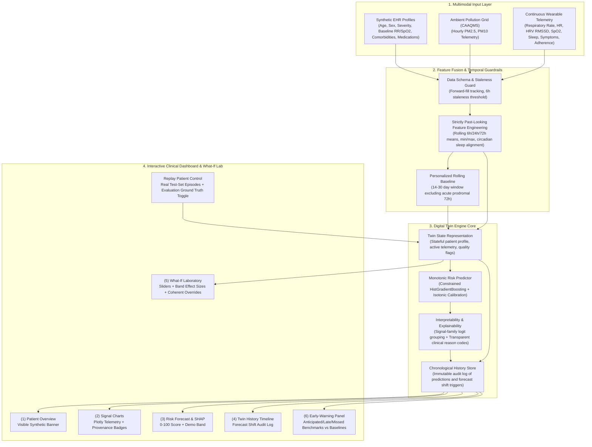

# RespiraTwin: End-to-End System Architecture

> **MANDATORY CLINICAL DISCLAIMER**: RespiraTwin is a simulation-based research prototype and proof-of-concept. All event labels, outcomes, and physiological sensor signals are generated by an epidemiological and physiological simulator. RespiraTwin does **not** claim real-world clinical accuracy and must **never** be used for clinical decision-making or treatment planning.

---

## 1. High-Level Architecture Diagram

The RespiraTwin digital twin pipeline ingests multimodal static and dynamic data streams, executes strict temporal feature fusion with zero lookahead leakage, drives a stateful digital twin engine with monotonic ML inference, and exposes an interactive clinical control station and counterfactual what-if laboratory.



---

## 2. Core Architectural Subsystems

### 2.1 Multimodal Ingestion Layer
- **Synthetic EHR Records (`src/load_ehr.py`)**: Realistic static patient demographic and clinical characteristics (severity, prior exacerbations in 12 months, prescribed maintenance controllers, baseline respiratory rate, baseline pulse oximetry, and comorbid allergic rhinitis, GERD, obesity, hypertension).
- **Continuous Ambient Air Quality Monitoring Station (CAAQMS) (`src/ingest_pollution.py`)**: Hourly continuous PM2.5 and PM10 concentrations reflecting urban atmospheric dynamics, diurnal rush-hour peaks, and episodic meteorological inversions.
- **Continuous Wearable Telemetry (`src/simulate_wearables.py`)**: Continuous multi-sensor BLE streams capturing respiratory rate (acoustic sensing), pulse oximetry (PPG SpO2), cardiac autonomic tone (HR and HRV RMSSD), sleep duration, daily rescue inhaler usage, and patient symptom diary entries.

### 2.2 Feature Fusion & Temporal Leakage Guardrails (`src/build_features.py`)
- **Strictly Past-Looking Windows**: All 52 engineered features utilize strictly historical rolling aggregations (6h, 24h, 72h). Future timestamps are inaccessible to prevent future lookahead leakage.
- **Causal Sleep Alignment**: Sleep duration is attributed only after the nocturnal monitoring period concludes, preventing same-day lookahead contamination.
- **Personalized Baseline Computation**: Calculated across a 14-to-30-day lookback window that **explicitly excludes the most recent 72 hours**. This prevents acute pre-attack prodromal deterioration from contaminating the stable personal norm.
- **Telemetry Staleness Detection**: Sensor missingness is forward-filled within each individual patient. If any telemetry channel remains unobserved for $>6$ hours, a `stale_channels` alert flag is attached to the twin's state.

### 2.3 Twin Engine Core (`src/digital_twin.py`, `src/predict_risk.py`, `src/explain_prediction.py`)
- **Stateful Representation**: The `DigitalTwin` class encapsulates patient profile, telemetry buffers, personalized baselines, data quality flags, and chronological trajectory history.
- **Monotonic HistGradientBoosting Classifier**: Incorporates 25 pathophysiological domain constraints. Enforces non-decreasing risk under worsening air pollution, escalating tachypnea, dropping oxygen saturation, and escalating rescue inhaler use, alongside non-increasing risk under improved controller adherence.
- **Isotonic Calibration**: Post-hoc probability calibrator trained strictly on validation split patient data, aligning predicted probabilities with true empirical event rates (Brier score $0.0526$, calibration slope $0.9786$).
- **Interpretability via Signal-Family Grouping**: Risk attributions are aggregated into 5 clinically intuitive families: *Pollution Exposure*, *Breathing & Oxygenation*, *Rescue & Symptoms*, *Medication Adherence*, and *Patient History*. Feature contributions are translated into human-readable clinical reason code bullets.
- **Non-Destructive Counterfactual What-If Simulation**: In `twin.what_if()`, hypothetical interventions create isolated feature copies with coherent cascading updates (e.g., PM2.5 shifts update all 6h, 24h, and 72h mean/max derivations simultaneously) without mutating stored historical twin states.

### 2.4 Doctor-Facing Dashboard & Decision Support (`app.py`)
Built with Streamlit and Plotly across 6 cohesive tabs:
1. **Patient Overview**: Prominent "SYNTHETIC PATIENT" banner, clinical EHR demographics, and sensor telemetry health metrics.
2. **Multimodal Signals**: Synchronized interactive Plotly charts showing ambient PM2.5/AQI, respiratory rate, SpO2, heart rate, HRV RMSSD, adherence, rescue inhaler puffs, and symptom scores with provenance badges and missing-data flags.
3. **Risk Forecast & SHAP**: Integer 0-100 score, demonstration risk bands (Low, Watch, High), last-updated timestamp, signal-family grouped bar charts, and transparent reason code bullets.
4. **Twin History Timeline**: Chronological trajectory graph tracking risk evolution over time, paired with an automated shift audit log detailing why the forecast shifted.
5. **What-If Laboratory**: Dynamic scenario sliders with test-set effect sizes displayed next to each slider ("typical effect for patients in this risk band", with adherence labeled as "small effect in this model"), preset interventions, side-by-side comparison cards, and a reset button.
6. **Early-Warning Evaluation**: Full holdout test-set benchmarks displaying anticipated vs. late vs. missed onsets, median lead time (12.0 hours), alert precision vs. the baseline PM2.5 rule, and stricter false-alert accounting from `models/metrics.json`.
7. **Replay Patient Control**: Step-by-step replay of real test-set episodes (48h pre-onset to 12h post-onset) with an optional evaluation ground-truth toggle (off by default) and honest alert reporting for silent episodes.

---

## 3. Data Flow & State Immutability Guarantees

```
[Raw Observations at Time t]
         │
         ▼
[Telemetry Staleness Check] ──> Data Quality Metadata Attached
         │
         ▼
[Causal Feature Pipeline]   ──> Point-in-time Feature Vector (52 dims)
         │
         ▼
[Digital Twin State Update] ──> Appended to Chronological History (Immutable)
         │
         ▼
[Calibrated Predictor]      ──> 24h Exacerbation Risk (0-100 Score + Demo Band)
         │
         ▼
[Signal Family Explainer]   ──> Attribution Vectors + Clinical Reason Codes
         │
         ▼
[Doctor Dashboard (app.py)] ──> Interactive Visualization & Clinical Audit
```

### Safety & Integrity Assertions:
1. **Historical Immutability**: Historical observations and past prediction logs are append-only. Running counterfactual what-if simulations operates on deep copies and cannot alter stored history.
2. **No Data Leakage**: Latent vulnerability factors are stored exclusively in `data/latent_truth.csv` and never enter the ML training pipelines or feature schemas.
3. **Reproducibility**: All dataset generation and model training scripts use deterministic pseudo-random seeds (`seed=42`) with serialized parameter sidecars.
